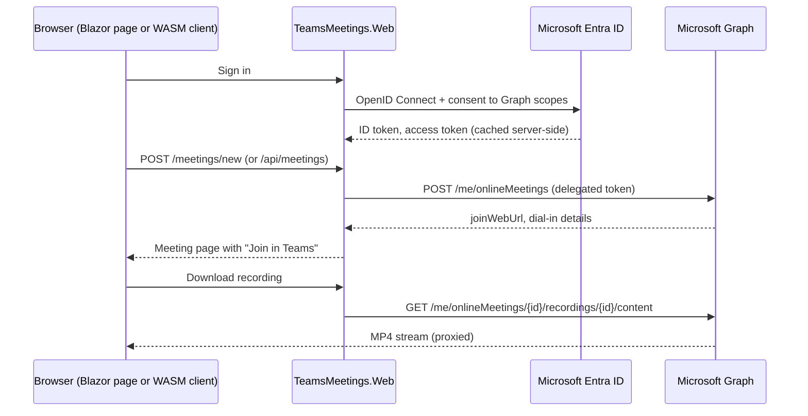

# Teams meetings from Blazor with Microsoft Graph

[](https://github.com/Roshankm/blazor-teams-graph-sample/actions/workflows/ci.yml)


A .NET 10 Blazor app that **creates Microsoft Teams meetings, opens join links, and downloads meeting recordings and transcripts** through Microsoft Graph, on behalf of the signed-in user.

It runs immediately in **demo mode** with in-memory data. Add an Entra ID app registration and it switches to the real Microsoft Graph.

## What it shows

| Area | Details |
|---|---|
| **Microsoft Graph** | `POST /me/onlineMeetings`, lookup by `JoinWebUrl`, `/recordings` and `/transcripts` with content download, using the Graph SDK v5 |
| **Entra ID sign-in** | Microsoft.Identity.Web OpenID Connect sign-in, delegated scopes, token acquisition for Graph, and automatic re-sign-in when a token can't be acquired silently |
| **Backend-for-frontend** | The browser never holds a Graph token. Pages and a JSON API (`/api/meetings`) call Graph from the server, so a Blazor WebAssembly client can use the same API |
| **Time zones** | Meetings are entered in the organiser's zone (IANA IDs, DST-aware) and sent to Graph in UTC |
| **Error handling** | Graph `403/404/429` errors become messages that tell the user or admin what to fix |
| **Blazor** | .NET 10 static server rendering with enhanced forms; no WebSocket circuit is needed |
| **Quality** | Unit tests, `WebApplicationFactory` integration tests, warnings as errors, central package management, CI on every push |

## Run it

Prerequisite: [.NET 10 SDK](https://dotnet.microsoft.com/download).

```bash
git clone https://github.com/Roshankm/blazor-teams-graph-sample.git
cd blazor-teams-graph-sample
dotnet run --project src/TeamsMeetings.Web --launch-profile https
```

Open https://localhost:7215. In demo mode, try the seeded **Weekly delivery sync** meeting: it has a recording and a transcript you can download.

To use real Teams data, follow **[docs/entra-setup.md](docs/entra-setup.md)**. It takes about 10 minutes.

```bash
dotnet test
```

## How it works



```
src/
  TeamsMeetings.Core    Models, validation, time zones, ITeamsMeetingService, demo implementation
  TeamsMeetings.Graph   Microsoft Graph implementation and error mapping
  TeamsMeetings.Web     Blazor pages, JSON API, Entra ID sign-in
tests/
  TeamsMeetings.Tests   Unit + integration tests
```

## API

| Method | Route | Description |
|---|---|---|
| `POST` | `/api/meetings` | Create a meeting |
| `GET` | `/api/meetings?joinUrl=` | Find a meeting by its Teams join link |
| `GET` | `/api/meetings/{id}` | Get a meeting |
| `GET` | `/api/meetings/{id}/artifacts` | List recordings and transcripts |
| `GET` | `/meetings/{id}/recordings/{recordingId}/content` | Download a recording (MP4) |
| `GET` | `/meetings/{id}/transcripts/{transcriptId}/content` | Download a transcript (VTT) |

## Design notes

* **Why look meetings up by join link?** Graph has no endpoint that lists a user's online meetings. Calendar events carry the join link, so that is the reliable key.
* **Why static server rendering?** Every Graph call then runs inside a normal HTTP request, where Microsoft.Identity.Web can acquire tokens and trigger a sign-in challenge. Interactive Server circuits make that harder.
* **Why proxy downloads?** Recording URLs need a Graph token. Streaming them through the server keeps tokens out of the browser.

## Roadmap

- [ ] Create the meeting as a calendar event with attendees (`/me/events` with `isOnlineMeeting`)
- [ ] Distributed token cache (SQL Server) for multi-instance hosting
- [ ] Blazor WebAssembly client project calling `/api/meetings`
- [ ] Teams tab manifest so the app runs inside Teams

## License

[MIT](LICENSE)
